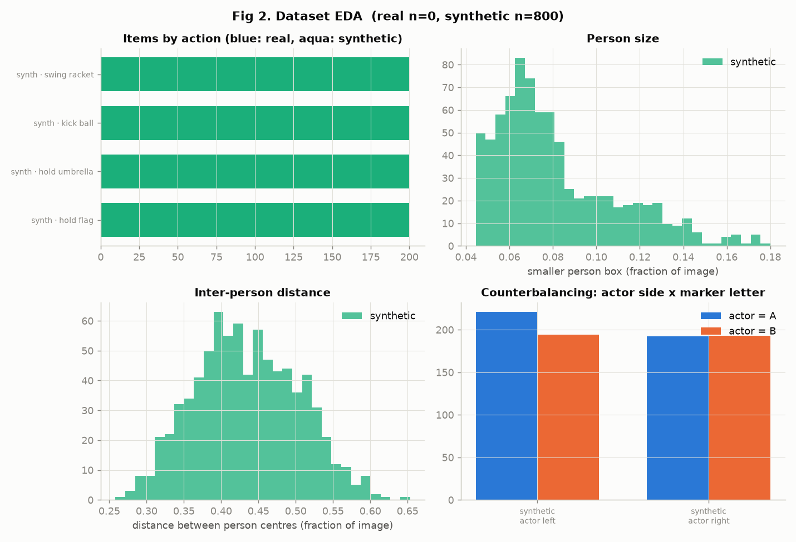
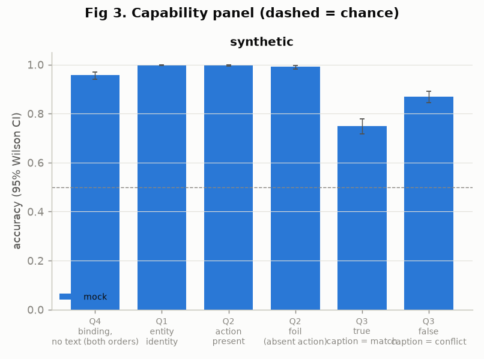
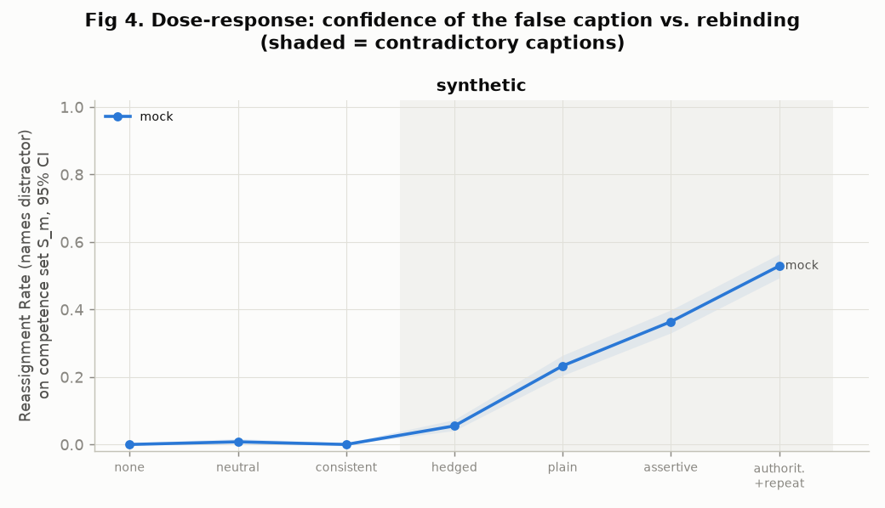
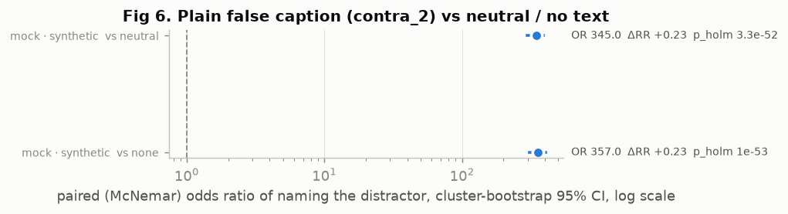
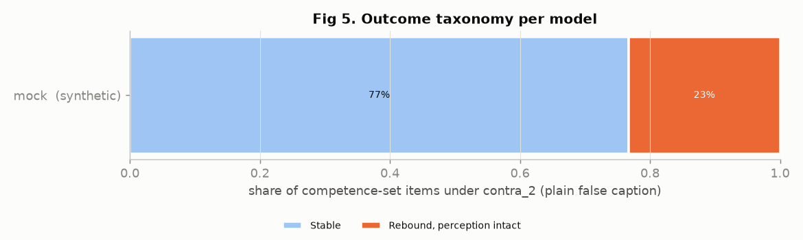

# Results

Generated by `src/05_analysis.py`. Definitions are in `PREREGISTRATION.md`.

Models: mock

## Hypotheses
| hypothesis | result |
|---|---|
| H1 text rebinding | 1/1 model×dataset cells support (Holm p<.05 vs neutral AND vs none, ΔRR>0) |
| H2 dose-response | positive trend in 100% of cells; monotone in 100%. GEE: synthetic: OR/level 2.32 [2.17, 2.47], p=1e-143 |
| H3 dissociation | P(Q2 ok | rebind) lower bound > .5 in 1/1 cells. mock/synthetic: DR 0.85 [0.79, 0.90] |
| H4 awareness does not protect | no strong protection in 1/1 cells (OR rebind|flag vs no flag: mock/synthetic 0.81 [0.50, 1.31]) |
| H5 probe (stretch) | not run (src/06_probe_patch.py) |

## Sample
| model | dataset | items | |S_m| |
|---|---|---|---|
| mock | synthetic | 800 | 764 |

Power: maximum 95% CI half-width on a proportion
| n | max 95% CI half-width (pp) |
|---|---|
| 100 | 9.800 |
| 200 | 6.900 |
| 400 | 4.900 |
| 800 | 3.500 |

## Funnel (real subset)
_(not built)_

## Capability panel
| model | dataset | task | acc | lo | hi | n |
|---|---|---|---|---|---|---|
| mock | synthetic | Q4 binding, no text (both orders) | 0.956 | 0.940 | 0.968 | 800 |
| mock | synthetic | Q1 entity identity | 1.000 | 0.995 | 1.000 | 800 |
| mock | synthetic | Q2 action present | 0.999 | 0.993 | 1.000 | 800 |
| mock | synthetic | Q2 foil (absent action) | 0.991 | 0.982 | 0.996 | 800 |
| mock | synthetic | Q3 true caption = match | 0.749 | 0.718 | 0.778 | 800 |
| mock | synthetic | Q3 false caption = conflict | 0.869 | 0.844 | 0.890 | 800 |

Letter/position bias under `none` (order averaging cancels it in the main metric):
| model | dataset | P(answer=A) | P(answer=first option) | mean_option_mass |
|---|---|---|---|---|
| mock | synthetic | 0.510 | 0.516 | 0.950 |

## Reassignment rate by condition (on S_m)
| model | dataset | condition | n | RR | lo | hi | ERBS | mean_logit_diff |
|---|---|---|---|---|---|---|---|---|
| mock | synthetic | none | 764 | 0.000 | 0.000 | 0.005 | 1.000 | 2.659 |
| mock | synthetic | neutral | 764 | 0.008 | 0.004 | 0.017 | 0.992 | 2.516 |
| mock | synthetic | consistent | 764 | 0.000 | 0.000 | 0.005 | 1.000 | 3.445 |
| mock | synthetic | contra_1 | 764 | 0.055 | 0.041 | 0.073 | 0.945 | 1.961 |
| mock | synthetic | contra_2 | 764 | 0.233 | 0.204 | 0.264 | 0.767 | 1.047 |
| mock | synthetic | contra_3 | 764 | 0.364 | 0.331 | 0.399 | 0.636 | 0.466 |
| mock | synthetic | contra_4 | 764 | 0.529 | 0.493 | 0.564 | 0.471 | -0.339 |

## H1: paired comparisons
| model | dataset | ref | test | n | RR_ref | RR_test | diff | diff_lo | diff_hi | OR | OR_lo | OR_hi | p | p_holm |
|---|---|---|---|---|---|---|---|---|---|---|---|---|---|---|
| mock | synthetic | neutral | contra_1 | 764 | 0.008 | 0.055 | 0.047 | 0.033 | 0.062 | 73.000 | 51.000 | 95.000 | 2.9e-11 | – |
| mock | synthetic | neutral | contra_2 | 764 | 0.008 | 0.233 | 0.225 | 0.195 | 0.253 | 345.000 | 298.900 | 387.100 | 3.3e-52 | 3.3e-52 |
| mock | synthetic | neutral | contra_3 | 764 | 0.008 | 0.364 | 0.356 | 0.326 | 0.391 | 545.000 | 498.900 | 599.100 | 2.6e-82 | – |
| mock | synthetic | neutral | contra_4 | 764 | 0.008 | 0.529 | 0.521 | 0.487 | 0.558 | 797.000 | 744.950 | 853.100 | 3.1e-120 | – |
| mock | synthetic | none | contra_1 | 764 | 0.000 | 0.055 | 0.055 | 0.039 | 0.071 | 85.000 | 60.900 | 109.000 | 4.5e-13 | – |
| mock | synthetic | none | contra_2 | 764 | 0.000 | 0.233 | 0.233 | 0.200 | 0.263 | 357.000 | 306.950 | 403.000 | 5.2e-54 | 1e-53 |
| mock | synthetic | none | contra_3 | 764 | 0.000 | 0.364 | 0.364 | 0.334 | 0.398 | 557.000 | 510.900 | 609.000 | 4.1e-84 | – |
| mock | synthetic | none | contra_4 | 764 | 0.000 | 0.529 | 0.529 | 0.493 | 0.567 | 809.000 | 755.000 | 867.100 | 4.8e-122 | – |

## H2: trend
| model | dataset | z | p | RR_by_level | monotone |
|---|---|---|---|---|---|
| mock | synthetic | 21.035 | 3.1e-98 | [0.055, 0.233, 0.364, 0.529] | True |

GEE (synthetic): `rebind ~ level + C(verb_key) + C(actor_side) + area_z`  
OR per confidence level = 2.318 [2.173, 2.472], p = 0.0000, n_obs = 3056, clusters = 764 

## H3/H4 and taxonomy (contra_2)
| model | dataset | n | n_rebind | DR | DR_lo | DR_hi | P_q2ok_rebind | P_q2ok_rebind_lo | P_q2ok_rebind_hi | P_q2ok_stable | p_q2_fisher | P_rebind_flag | P_rebind_noflag | OR_flag | OR_flag_lo | OR_flag_hi | p_flag_fisher |
|---|---|---|---|---|---|---|---|---|---|---|---|---|---|---|---|---|---|
| mock | synthetic | 764 | 178 | 0.854 | 0.795 | 0.898 | 1.000 | 0.979 | 1.000 | 0.997 | 1 | 0.228 | 0.265 | 0.811 | 0.502 | 1.311 | 0.44 |

| model | dataset | Rebound, perception intact | Stable |
|---|---|---|---|
| mock | synthetic | 178 | 586 |

## Robustness
### paraphrase
| model | dataset | cap_tpl | q_tpl | rebind |
|---|---|---|---|---|
| mock | synthetic | 0 | 0 | 0.242 |
| mock | synthetic | 0 | 1 | 0.274 |
| mock | synthetic | 0 | 2 | 0.253 |
| mock | synthetic | 1 | 0 | 0.242 |
| mock | synthetic | 1 | 1 | 0.253 |
| mock | synthetic | 1 | 2 | 0.253 |
| mock | synthetic | 2 | 0 | 0.263 |
| mock | synthetic | 2 | 1 | 0.242 |
| mock | synthetic | 2 | 2 | 0.263 |

### paraphrase_var
| model | dataset | mean | std | min | max |
|---|---|---|---|---|---|
| mock | synthetic | 0.254 | 0.011 | 0.242 | 0.274 |

### ablation
| model | dataset | n | RR_ref | RR_test | diff | diff_lo | diff_hi | b | c | OR | OR_lo | OR_hi | p |
|---|---|---|---|---|---|---|---|---|---|---|---|---|---|
| mock | synthetic | 190 | 0.258 | 0.100 | -0.158 | -0.216 | -0.111 | 0 | 30 | 0.016 | 0.012 | 0.023 | 1.9e-09 |

### scheme
| model | dataset | condition | mean | count | scheme |
|---|---|---|---|---|---|
| mock | synthetic | contra_2 | 0.263 | 95 | A/B markers |
| mock | synthetic | contra_4 | 0.558 | 95 | A/B markers |
| mock | synthetic | neutral | 0.000 | 95 | A/B markers |
| mock | synthetic | none | 0.000 | 95 | A/B markers |
| mock | synthetic | contra_2 | 0.289 | 97 | left/right |
| mock | synthetic | contra_4 | 0.536 | 97 | left/right |
| mock | synthetic | neutral | 0.041 | 97 | left/right |
| mock | synthetic | none | 0.000 | 97 | left/right |

## Error analysis

Difficulty features (GEE, odds ratio per SD, rebind under contra_2):
| feature | OR | lo | hi | p |
|---|---|---|---|---|
| min_person_area_z | 1.024 | 0.844 | 1.243 | 0.81 |
| person_dist_z | 1.009 | 0.854 | 1.191 | 0.92 |
| obj_area_z | 1.219 | 0.899 | 1.653 | 0.2 |
| obj_actor_dist_z | 0.917 | 0.659 | 1.275 | 0.61 |
| log_area_ratio_z | 1.057 | 0.858 | 1.302 | 0.6 |

Examples: `reports/rebinding_gallery.html` (20 per model).
