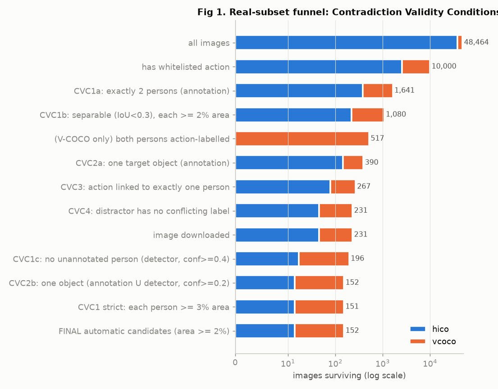
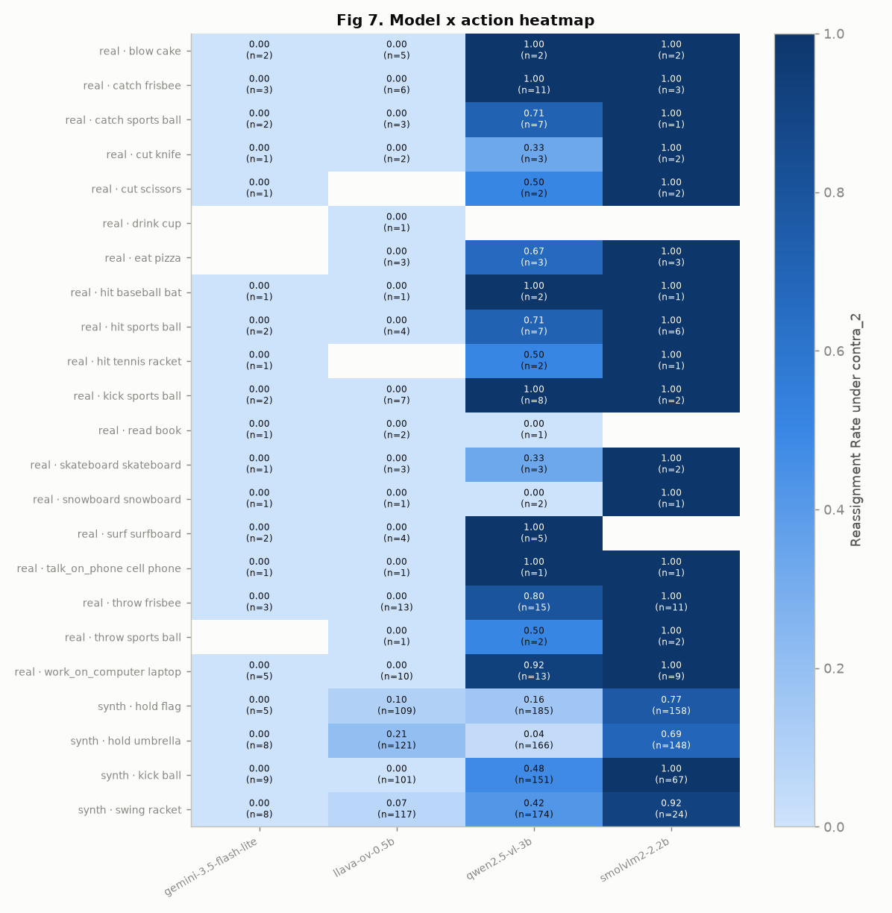

# Results

Generated by `src/analyze_results.py`. Definitions are in `PREREGISTRATION.md`.

Models: gemini-3.5-flash-lite, llava-ov-0.5b, qwen2.5-vl-3b, smolvlm2-2.2b

## Hypotheses
| hypothesis | result |
|---|---|
| H1 text rebinding | 4/8 model×dataset cells support (Holm p<.05 vs neutral AND vs none, ΔRR>0) |
| H2 dose-response | positive trend in 88% of cells; monotone in 62%. GEE: real: OR/level 3.46 [2.85, 4.18], p=5.3e-37; synthetic: OR/level 2.22 [2.10, 2.34], p=3.2e-171 |
| H3 dissociation | P(Q2 ok | rebind) lower bound > .5 in 5/5 cells. llava-ov-0.5b/synthetic: DR 0.02 [0.00, 0.12]; qwen2.5-vl-3b/real: DR 0.51 [0.40, 0.63]; qwen2.5-vl-3b/synthetic: DR 0.54 [0.46, 0.61]; smolvlm2-2.2b/real: DR 0.00 [0.00, 0.07]; smolvlm2-2.2b/synthetic: DR 0.00 [0.00, 0.01] |
| H4 awareness does not protect | no strong protection in 8/8 cells (OR rebind|flag vs no flag: gemini-3.5-flash-lite/real 0.02 [0.00, 2.09]; gemini-3.5-flash-lite/synthetic 0.02 [0.00, 2.02]; llava-ov-0.5b/real 133.00 [1.09, 16274.61]; llava-ov-0.5b/synthetic 27.90 [1.12, 695.35]; qwen2.5-vl-3b/real 0.03 [0.00, 0.55]; qwen2.5-vl-3b/synthetic 0.25 [0.17, 0.36]; smolvlm2-2.2b/real 0.01 [0.00, 1.24]; smolvlm2-2.2b/synthetic 0.28 [0.01, 14.07]) |
| H5 probe (stretch) | NOT supported (representation itself flips: probe reads the caption's person): layer 34 (probe acc on `none` 0.92; decodable from layer 23) recovers the true actor on 0.22 [0.15, 0.31] of 101 output-flipped items (qwen2.5-vl-3b) |

## Sample
| model | dataset | items | |S_m| |
|---|---|---|---|
| gemini-3.5-flash-lite | real | 30 | 59 |
| gemini-3.5-flash-lite | synthetic | 30 | 59 |
| llava-ov-0.5b | real | 152 | 515 |
| llava-ov-0.5b | synthetic | 800 | 515 |
| qwen2.5-vl-3b | real | 152 | 765 |
| qwen2.5-vl-3b | synthetic | 800 | 765 |
| smolvlm2-2.2b | real | 152 | 446 |
| smolvlm2-2.2b | synthetic | 800 | 446 |

Power: maximum 95% CI half-width on a proportion
| n | max 95% CI half-width (pp) |
|---|---|
| 100 | 9.800 |
| 152 | 7.900 |
| 200 | 6.900 |
| 400 | 4.900 |
| 800 | 3.500 |

## Funnel (real subset)
| stage | hico | vcoco | total |
|---|---|---|---|
| all images | 38118 | 10346 | 48464 |
| has whitelisted action | 2569 | 7431 | 10000 |
| CVC1a: exactly 2 persons (annotation) | 383 | 1258 | 1641 |
| CVC1b: separable (IoU<0.3), each >= 2% area | 218 | 862 | 1080 |
| (V-COCO only) both persons action-labelled | 0 | 517 | 517 |
| CVC2a: one target object (annotation) | 146 | 244 | 390 |
| CVC3: action linked to exactly one person | 79 | 188 | 267 |
| CVC4: distractor has no conflicting label | 45 | 186 | 231 |
| image downloaded | 45 | 186 | 231 |
| CVC1c: no unannotated person (detector, conf>=0.4) | 17 | 179 | 196 |
| CVC2b: one object (annotation U detector, conf>=0.2) | 14 | 138 | 152 |
| CVC1 strict: each person >= 3% area | 14 | 137 | 151 |
| FINAL automatic candidates (area >= 2%) | 14 | 138 | 152 |

## Capability panel
| model | dataset | task | acc | lo | hi | n |
|---|---|---|---|---|---|---|
| gemini-3.5-flash-lite | real | Q4 binding, no text (both orders) | 0.967 | 0.833 | 0.994 | 30 |
| gemini-3.5-flash-lite | synthetic | Q4 binding, no text (both orders) | 1.000 | 0.886 | 1.000 | 30 |
| llava-ov-0.5b | real | Q4 binding, no text (both orders) | 0.546 | 0.467 | 0.623 | 152 |
| llava-ov-0.5b | synthetic | Q4 binding, no text (both orders) | 0.565 | 0.530 | 0.599 | 800 |
| qwen2.5-vl-3b | real | Q4 binding, no text (both orders) | 0.691 | 0.613 | 0.759 | 152 |
| qwen2.5-vl-3b | synthetic | Q4 binding, no text (both orders) | 0.981 | 0.969 | 0.989 | 800 |
| smolvlm2-2.2b | real | Q4 binding, no text (both orders) | 0.454 | 0.377 | 0.533 | 152 |
| smolvlm2-2.2b | synthetic | Q4 binding, no text (both orders) | 0.769 | 0.738 | 0.797 | 800 |
| llava-ov-0.5b | real | Q1 entity identity | 0.541 | 0.460 | 0.619 | 148 |
| llava-ov-0.5b | synthetic | Q1 entity identity | 0.571 | 0.537 | 0.605 | 800 |
| qwen2.5-vl-3b | real | Q1 entity identity | 0.696 | 0.618 | 0.764 | 148 |
| qwen2.5-vl-3b | synthetic | Q1 entity identity | 1.000 | 0.995 | 1.000 | 800 |
| smolvlm2-2.2b | real | Q1 entity identity | 0.250 | 0.187 | 0.325 | 148 |
| smolvlm2-2.2b | synthetic | Q1 entity identity | 0.792 | 0.763 | 0.819 | 800 |
| llava-ov-0.5b | real | Q2 action present | 0.829 | 0.761 | 0.881 | 152 |
| llava-ov-0.5b | synthetic | Q2 action present | 0.994 | 0.985 | 0.997 | 800 |
| qwen2.5-vl-3b | real | Q2 action present | 0.809 | 0.739 | 0.864 | 152 |
| qwen2.5-vl-3b | synthetic | Q2 action present | 0.859 | 0.833 | 0.881 | 800 |
| smolvlm2-2.2b | real | Q2 action present | 0.711 | 0.634 | 0.777 | 152 |
| smolvlm2-2.2b | synthetic | Q2 action present | 0.620 | 0.586 | 0.653 | 800 |
| llava-ov-0.5b | real | Q2 foil (absent action) | 0.934 | 0.883 | 0.964 | 152 |
| llava-ov-0.5b | synthetic | Q2 foil (absent action) | 0.989 | 0.979 | 0.994 | 800 |
| qwen2.5-vl-3b | real | Q2 foil (absent action) | 0.947 | 0.900 | 0.973 | 152 |
| qwen2.5-vl-3b | synthetic | Q2 foil (absent action) | 0.981 | 0.969 | 0.989 | 800 |
| smolvlm2-2.2b | real | Q2 foil (absent action) | 0.961 | 0.917 | 0.982 | 152 |
| smolvlm2-2.2b | synthetic | Q2 foil (absent action) | 1.000 | 0.995 | 1.000 | 800 |
| llava-ov-0.5b | real | Q3 true caption = match | 0.961 | 0.917 | 0.982 | 152 |
| llava-ov-0.5b | synthetic | Q3 true caption = match | 0.999 | 0.993 | 1.000 | 800 |
| qwen2.5-vl-3b | real | Q3 true caption = match | 0.763 | 0.690 | 0.824 | 152 |
| qwen2.5-vl-3b | synthetic | Q3 true caption = match | 0.973 | 0.959 | 0.982 | 800 |
| smolvlm2-2.2b | real | Q3 true caption = match | 0.993 | 0.964 | 0.999 | 152 |
| smolvlm2-2.2b | synthetic | Q3 true caption = match | 1.000 | 0.995 | 1.000 | 800 |
| gemini-3.5-flash-lite | real | Q3 false caption = conflict | 0.967 | 0.833 | 0.994 | 30 |
| gemini-3.5-flash-lite | synthetic | Q3 false caption = conflict | 1.000 | 0.886 | 1.000 | 30 |
| llava-ov-0.5b | real | Q3 false caption = conflict | 0.039 | 0.018 | 0.083 | 152 |
| llava-ov-0.5b | synthetic | Q3 false caption = conflict | 0.004 | 0.001 | 0.011 | 800 |
| qwen2.5-vl-3b | real | Q3 false caption = conflict | 0.625 | 0.546 | 0.698 | 152 |
| qwen2.5-vl-3b | synthetic | Q3 false caption = conflict | 0.759 | 0.728 | 0.787 | 800 |
| smolvlm2-2.2b | real | Q3 false caption = conflict | 0.007 | 0.001 | 0.036 | 152 |
| smolvlm2-2.2b | synthetic | Q3 false caption = conflict | 0.000 | 0.000 | 0.005 | 800 |

Letter/position bias under `none` (order averaging cancels it in the main metric):
| model | dataset | P(answer=A) | P(answer=first option) | mean_option_mass |
|---|---|---|---|---|
| gemini-3.5-flash-lite | real | 0.600 | 0.500 | – |
| gemini-3.5-flash-lite | synthetic | 0.533 | 0.500 | – |
| llava-ov-0.5b | real | 0.984 | 0.516 | 0.992 |
| llava-ov-0.5b | synthetic | 0.894 | 0.554 | 0.969 |
| qwen2.5-vl-3b | real | 0.661 | 0.464 | 0.999 |
| qwen2.5-vl-3b | synthetic | 0.523 | 0.497 | 0.999 |
| smolvlm2-2.2b | real | 0.395 | 0.539 | 0.998 |
| smolvlm2-2.2b | synthetic | 0.412 | 0.596 | 0.998 |

## Reassignment rate by condition (on S_m)
| model | dataset | condition | n | RR | lo | hi | ERBS | mean_logit_diff |
|---|---|---|---|---|---|---|---|---|
| gemini-3.5-flash-lite | real | none | 29 | 0.000 | 0.000 | 0.117 | 1.000 | – |
| gemini-3.5-flash-lite | real | neutral | 29 | 0.000 | 0.000 | 0.117 | 1.000 | – |
| gemini-3.5-flash-lite | real | consistent | 29 | 0.000 | 0.000 | 0.117 | 1.000 | – |
| gemini-3.5-flash-lite | real | contra_1 | 29 | 0.000 | 0.000 | 0.117 | 1.000 | – |
| gemini-3.5-flash-lite | real | contra_2 | 29 | 0.000 | 0.000 | 0.117 | 1.000 | – |
| gemini-3.5-flash-lite | real | contra_4 | 29 | 0.069 | 0.019 | 0.220 | 0.931 | – |
| gemini-3.5-flash-lite | synthetic | none | 30 | 0.000 | 0.000 | 0.114 | 1.000 | – |
| gemini-3.5-flash-lite | synthetic | neutral | 30 | 0.000 | 0.000 | 0.114 | 1.000 | – |
| gemini-3.5-flash-lite | synthetic | consistent | 30 | 0.000 | 0.000 | 0.114 | 1.000 | – |
| gemini-3.5-flash-lite | synthetic | contra_1 | 30 | 0.000 | 0.000 | 0.114 | 1.000 | – |
| gemini-3.5-flash-lite | synthetic | contra_2 | 30 | 0.000 | 0.000 | 0.114 | 1.000 | – |
| gemini-3.5-flash-lite | synthetic | contra_4 | 30 | 0.000 | 0.000 | 0.114 | 1.000 | – |
| llava-ov-0.5b | real | none | 67 | 0.000 | 0.000 | 0.054 | 1.000 | 0.753 |
| llava-ov-0.5b | real | neutral | 67 | 0.000 | 0.000 | 0.054 | 1.000 | 0.322 |
| llava-ov-0.5b | real | consistent | 67 | 0.000 | 0.000 | 0.054 | 1.000 | 0.743 |
| llava-ov-0.5b | real | contra_1 | 67 | 0.000 | 0.000 | 0.054 | 1.000 | 0.323 |
| llava-ov-0.5b | real | contra_2 | 67 | 0.000 | 0.000 | 0.054 | 1.000 | 0.280 |
| llava-ov-0.5b | real | contra_3 | 67 | 0.104 | 0.052 | 0.200 | 0.896 | 0.200 |
| llava-ov-0.5b | real | contra_4 | 67 | 0.955 | 0.876 | 0.985 | 0.045 | -0.246 |
| llava-ov-0.5b | synthetic | none | 448 | 0.000 | 0.000 | 0.009 | 1.000 | 0.903 |
| llava-ov-0.5b | synthetic | neutral | 448 | 0.058 | 0.040 | 0.084 | 0.942 | 0.167 |
| llava-ov-0.5b | synthetic | consistent | 448 | 0.054 | 0.036 | 0.078 | 0.946 | 0.362 |
| llava-ov-0.5b | synthetic | contra_1 | 448 | 0.089 | 0.066 | 0.119 | 0.911 | 0.193 |
| llava-ov-0.5b | synthetic | contra_2 | 448 | 0.098 | 0.074 | 0.129 | 0.902 | 0.192 |
| llava-ov-0.5b | synthetic | contra_3 | 448 | 0.100 | 0.076 | 0.132 | 0.900 | 0.174 |
| llava-ov-0.5b | synthetic | contra_4 | 448 | 0.623 | 0.577 | 0.666 | 0.377 | -0.041 |
| qwen2.5-vl-3b | real | none | 89 | 0.000 | 0.000 | 0.041 | 1.000 | 0.842 |
| qwen2.5-vl-3b | real | neutral | 89 | 0.056 | 0.024 | 0.125 | 0.944 | 0.899 |
| qwen2.5-vl-3b | real | consistent | 89 | 0.000 | 0.000 | 0.041 | 1.000 | 1.631 |
| qwen2.5-vl-3b | real | contra_1 | 89 | 0.449 | 0.350 | 0.553 | 0.551 | 0.049 |
| qwen2.5-vl-3b | real | contra_2 | 89 | 0.787 | 0.690 | 0.859 | 0.213 | -0.375 |
| qwen2.5-vl-3b | real | contra_3 | 89 | 0.618 | 0.514 | 0.712 | 0.382 | -0.042 |
| qwen2.5-vl-3b | real | contra_4 | 89 | 0.831 | 0.740 | 0.895 | 0.169 | -0.364 |
| qwen2.5-vl-3b | synthetic | none | 676 | 0.000 | 0.000 | 0.006 | 1.000 | 1.474 |
| qwen2.5-vl-3b | synthetic | neutral | 676 | 0.000 | 0.000 | 0.006 | 1.000 | 1.737 |
| qwen2.5-vl-3b | synthetic | consistent | 676 | 0.000 | 0.000 | 0.006 | 1.000 | 2.276 |
| qwen2.5-vl-3b | synthetic | contra_1 | 676 | 0.071 | 0.054 | 0.093 | 0.929 | 0.602 |
| qwen2.5-vl-3b | synthetic | contra_2 | 676 | 0.269 | 0.237 | 0.304 | 0.731 | 0.267 |
| qwen2.5-vl-3b | synthetic | contra_3 | 676 | 0.096 | 0.076 | 0.121 | 0.904 | 0.432 |
| qwen2.5-vl-3b | synthetic | contra_4 | 676 | 0.393 | 0.357 | 0.431 | 0.607 | 0.044 |
| smolvlm2-2.2b | real | none | 49 | 0.000 | 0.000 | 0.073 | 1.000 | 0.331 |
| smolvlm2-2.2b | real | neutral | 49 | 0.143 | 0.071 | 0.267 | 0.857 | 0.246 |
| smolvlm2-2.2b | real | consistent | 49 | 0.000 | 0.000 | 0.073 | 1.000 | 0.898 |
| smolvlm2-2.2b | real | contra_1 | 49 | 0.653 | 0.513 | 0.771 | 0.347 | -0.067 |
| smolvlm2-2.2b | real | contra_2 | 49 | 1.000 | 0.927 | 1.000 | 0.000 | -0.589 |
| smolvlm2-2.2b | real | contra_3 | 49 | 1.000 | 0.927 | 1.000 | 0.000 | -0.475 |
| smolvlm2-2.2b | real | contra_4 | 49 | 1.000 | 0.927 | 1.000 | 0.000 | -0.856 |
| smolvlm2-2.2b | synthetic | none | 397 | 0.000 | 0.000 | 0.010 | 1.000 | 0.782 |
| smolvlm2-2.2b | synthetic | neutral | 397 | 0.060 | 0.041 | 0.088 | 0.940 | 0.543 |
| smolvlm2-2.2b | synthetic | consistent | 397 | 0.000 | 0.000 | 0.010 | 1.000 | 1.115 |
| smolvlm2-2.2b | synthetic | contra_1 | 397 | 0.516 | 0.467 | 0.565 | 0.484 | -0.047 |
| smolvlm2-2.2b | synthetic | contra_2 | 397 | 0.786 | 0.743 | 0.823 | 0.214 | -0.305 |
| smolvlm2-2.2b | synthetic | contra_3 | 397 | 0.753 | 0.708 | 0.793 | 0.247 | -0.309 |
| smolvlm2-2.2b | synthetic | contra_4 | 397 | 1.000 | 0.990 | 1.000 | 0.000 | -0.783 |

## H1: paired comparisons
| model | dataset | ref | test | n | RR_ref | RR_test | diff | diff_lo | diff_hi | OR | OR_lo | OR_hi | p | p_holm |
|---|---|---|---|---|---|---|---|---|---|---|---|---|---|---|
| gemini-3.5-flash-lite | real | neutral | contra_1 | 29 | 0.000 | 0.000 | 0.000 | 0.000 | 0.000 | 1.000 | 1.000 | 1.000 | 1 | – |
| gemini-3.5-flash-lite | real | neutral | contra_2 | 29 | 0.000 | 0.000 | 0.000 | 0.000 | 0.000 | 1.000 | 1.000 | 1.000 | 1 | 1 |
| gemini-3.5-flash-lite | real | neutral | contra_4 | 29 | 0.000 | 0.069 | 0.069 | 0.000 | 0.172 | 5.000 | 1.000 | 11.000 | 0.5 | – |
| gemini-3.5-flash-lite | real | none | contra_1 | 29 | 0.000 | 0.000 | 0.000 | 0.000 | 0.000 | 1.000 | 1.000 | 1.000 | 1 | – |
| gemini-3.5-flash-lite | real | none | contra_2 | 29 | 0.000 | 0.000 | 0.000 | 0.000 | 0.000 | 1.000 | 1.000 | 1.000 | 1 | 1 |
| gemini-3.5-flash-lite | real | none | contra_4 | 29 | 0.000 | 0.069 | 0.069 | 0.000 | 0.172 | 5.000 | 1.000 | 11.000 | 0.5 | – |
| gemini-3.5-flash-lite | synthetic | neutral | contra_1 | 30 | 0.000 | 0.000 | 0.000 | 0.000 | 0.000 | 1.000 | 1.000 | 1.000 | 1 | – |
| gemini-3.5-flash-lite | synthetic | neutral | contra_2 | 30 | 0.000 | 0.000 | 0.000 | 0.000 | 0.000 | 1.000 | 1.000 | 1.000 | 1 | 1 |
| gemini-3.5-flash-lite | synthetic | neutral | contra_4 | 30 | 0.000 | 0.000 | 0.000 | 0.000 | 0.000 | 1.000 | 1.000 | 1.000 | 1 | – |
| gemini-3.5-flash-lite | synthetic | none | contra_1 | 30 | 0.000 | 0.000 | 0.000 | 0.000 | 0.000 | 1.000 | 1.000 | 1.000 | 1 | – |
| gemini-3.5-flash-lite | synthetic | none | contra_2 | 30 | 0.000 | 0.000 | 0.000 | 0.000 | 0.000 | 1.000 | 1.000 | 1.000 | 1 | 1 |
| gemini-3.5-flash-lite | synthetic | none | contra_4 | 30 | 0.000 | 0.000 | 0.000 | 0.000 | 0.000 | 1.000 | 1.000 | 1.000 | 1 | – |
| llava-ov-0.5b | real | neutral | contra_1 | 67 | 0.000 | 0.000 | 0.000 | 0.000 | 0.000 | 1.000 | 1.000 | 1.000 | 1 | – |
| llava-ov-0.5b | real | neutral | contra_2 | 67 | 0.000 | 0.000 | 0.000 | 0.000 | 0.000 | 1.000 | 1.000 | 1.000 | 1 | 1 |
| llava-ov-0.5b | real | neutral | contra_3 | 67 | 0.000 | 0.104 | 0.104 | 0.030 | 0.179 | 15.000 | 5.000 | 25.000 | 0.016 | – |
| llava-ov-0.5b | real | neutral | contra_4 | 67 | 0.000 | 0.955 | 0.955 | 0.896 | 1.000 | 129.000 | 121.000 | 135.000 | 1.1e-19 | – |
| llava-ov-0.5b | real | none | contra_1 | 67 | 0.000 | 0.000 | 0.000 | 0.000 | 0.000 | 1.000 | 1.000 | 1.000 | 1 | – |
| llava-ov-0.5b | real | none | contra_2 | 67 | 0.000 | 0.000 | 0.000 | 0.000 | 0.000 | 1.000 | 1.000 | 1.000 | 1 | 1 |
| llava-ov-0.5b | real | none | contra_3 | 67 | 0.000 | 0.104 | 0.104 | 0.030 | 0.179 | 15.000 | 5.000 | 25.000 | 0.016 | – |
| llava-ov-0.5b | real | none | contra_4 | 67 | 0.000 | 0.955 | 0.955 | 0.896 | 1.000 | 129.000 | 121.000 | 135.000 | 1.1e-19 | – |
| llava-ov-0.5b | synthetic | neutral | contra_1 | 448 | 0.058 | 0.089 | 0.031 | -0.002 | 0.067 | 1.528 | 0.962 | 2.543 | 0.11 | – |
| llava-ov-0.5b | synthetic | neutral | contra_2 | 448 | 0.058 | 0.098 | 0.040 | 0.004 | 0.076 | 1.679 | 1.066 | 2.784 | 0.041 | 0.29 |
| llava-ov-0.5b | synthetic | neutral | contra_3 | 448 | 0.058 | 0.100 | 0.042 | 0.007 | 0.078 | 1.717 | 1.098 | 2.871 | 0.032 | – |
| llava-ov-0.5b | synthetic | neutral | contra_4 | 448 | 0.058 | 0.623 | 0.565 | 0.518 | 0.609 | 73.286 | 34.063 | 513.050 | 6.3e-72 | – |
| llava-ov-0.5b | synthetic | none | contra_1 | 448 | 0.000 | 0.089 | 0.089 | 0.065 | 0.116 | 81.000 | 59.000 | 105.000 | 1.8e-12 | – |
| llava-ov-0.5b | synthetic | none | contra_2 | 448 | 0.000 | 0.098 | 0.098 | 0.071 | 0.125 | 89.000 | 65.000 | 113.000 | 1.1e-13 | 1e-12 |
| llava-ov-0.5b | synthetic | none | contra_3 | 448 | 0.000 | 0.100 | 0.100 | 0.074 | 0.129 | 91.000 | 67.000 | 117.000 | 5.7e-14 | – |
| llava-ov-0.5b | synthetic | none | contra_4 | 448 | 0.000 | 0.623 | 0.623 | 0.580 | 0.665 | 559.000 | 520.950 | 597.000 | 2.1e-84 | – |
| qwen2.5-vl-3b | real | neutral | contra_1 | 89 | 0.056 | 0.449 | 0.393 | 0.281 | 0.506 | 24.333 | 9.286 | 87.000 | 5.5e-10 | – |
| qwen2.5-vl-3b | real | neutral | contra_2 | 89 | 0.056 | 0.787 | 0.730 | 0.629 | 0.820 | 131.000 | 113.000 | 147.000 | 5.4e-20 | 6e-19 |
| qwen2.5-vl-3b | real | neutral | contra_3 | 89 | 0.056 | 0.618 | 0.562 | 0.461 | 0.663 | 101.000 | 83.000 | 119.000 | 1.8e-15 | – |
| qwen2.5-vl-3b | real | neutral | contra_4 | 89 | 0.056 | 0.831 | 0.775 | 0.685 | 0.854 | 139.000 | 123.000 | 153.050 | 3.4e-21 | – |
| qwen2.5-vl-3b | real | none | contra_1 | 89 | 0.000 | 0.449 | 0.449 | 0.348 | 0.562 | 81.000 | 63.000 | 101.000 | 1.8e-12 | – |
| qwen2.5-vl-3b | real | none | contra_2 | 89 | 0.000 | 0.787 | 0.787 | 0.697 | 0.865 | 141.000 | 125.000 | 155.000 | 1.7e-21 | 2e-20 |
| qwen2.5-vl-3b | real | none | contra_3 | 89 | 0.000 | 0.618 | 0.618 | 0.517 | 0.719 | 111.000 | 93.000 | 129.000 | 5.6e-17 | – |
| qwen2.5-vl-3b | real | none | contra_4 | 89 | 0.000 | 0.831 | 0.831 | 0.742 | 0.899 | 149.000 | 133.000 | 161.000 | 1.1e-22 | – |
| qwen2.5-vl-3b | synthetic | neutral | contra_1 | 676 | 0.000 | 0.071 | 0.071 | 0.052 | 0.090 | 97.000 | 71.000 | 123.050 | 7.1e-15 | – |
| qwen2.5-vl-3b | synthetic | neutral | contra_2 | 676 | 0.000 | 0.269 | 0.269 | 0.235 | 0.302 | 365.000 | 318.950 | 409.000 | 3.3e-55 | 4.6e-54 |
| qwen2.5-vl-3b | synthetic | neutral | contra_3 | 676 | 0.000 | 0.096 | 0.096 | 0.074 | 0.120 | 131.000 | 101.000 | 163.000 | 5.4e-20 | – |
| qwen2.5-vl-3b | synthetic | neutral | contra_4 | 676 | 0.000 | 0.393 | 0.393 | 0.357 | 0.430 | 533.000 | 483.000 | 583.000 | 1.7e-80 | – |
| qwen2.5-vl-3b | synthetic | none | contra_1 | 676 | 0.000 | 0.071 | 0.071 | 0.052 | 0.090 | 97.000 | 71.000 | 123.050 | 7.1e-15 | – |
| qwen2.5-vl-3b | synthetic | none | contra_2 | 676 | 0.000 | 0.269 | 0.269 | 0.235 | 0.302 | 365.000 | 318.950 | 409.000 | 3.3e-55 | 4.6e-54 |
| qwen2.5-vl-3b | synthetic | none | contra_3 | 676 | 0.000 | 0.096 | 0.096 | 0.074 | 0.120 | 131.000 | 101.000 | 163.000 | 5.4e-20 | – |
| qwen2.5-vl-3b | synthetic | none | contra_4 | 676 | 0.000 | 0.393 | 0.393 | 0.357 | 0.430 | 533.000 | 483.000 | 583.000 | 1.7e-80 | – |
| smolvlm2-2.2b | real | neutral | contra_1 | 49 | 0.143 | 0.653 | 0.510 | 0.327 | 0.694 | 6.556 | 2.997 | 24.333 | 1.1e-05 | – |
| smolvlm2-2.2b | real | neutral | contra_2 | 49 | 0.143 | 1.000 | 0.857 | 0.755 | 0.959 | 85.000 | 75.000 | 95.000 | 4.5e-13 | 3.6e-12 |
| smolvlm2-2.2b | real | neutral | contra_3 | 49 | 0.143 | 1.000 | 0.857 | 0.755 | 0.959 | 85.000 | 75.000 | 95.000 | 4.5e-13 | – |
| smolvlm2-2.2b | real | neutral | contra_4 | 49 | 0.143 | 1.000 | 0.857 | 0.755 | 0.959 | 85.000 | 75.000 | 95.000 | 4.5e-13 | – |
| smolvlm2-2.2b | real | none | contra_1 | 49 | 0.000 | 0.653 | 0.653 | 0.510 | 0.776 | 65.000 | 51.000 | 77.000 | 4.7e-10 | – |
| smolvlm2-2.2b | real | none | contra_2 | 49 | 0.000 | 1.000 | 1.000 | 1.000 | 1.000 | 99.000 | 99.000 | 99.000 | 3.6e-15 | 3.6e-14 |
| smolvlm2-2.2b | real | none | contra_3 | 49 | 0.000 | 1.000 | 1.000 | 1.000 | 1.000 | 99.000 | 99.000 | 99.000 | 3.6e-15 | – |
| smolvlm2-2.2b | real | none | contra_4 | 49 | 0.000 | 1.000 | 1.000 | 1.000 | 1.000 | 99.000 | 99.000 | 99.000 | 3.6e-15 | – |
| smolvlm2-2.2b | synthetic | neutral | contra_1 | 397 | 0.060 | 0.516 | 0.456 | 0.408 | 0.506 | 363.000 | 325.000 | 403.000 | 6.5e-55 | – |
| smolvlm2-2.2b | synthetic | neutral | contra_2 | 397 | 0.060 | 0.786 | 0.725 | 0.683 | 0.771 | 577.000 | 543.000 | 613.000 | 4e-87 | 6e-86 |
| smolvlm2-2.2b | synthetic | neutral | contra_3 | 397 | 0.060 | 0.753 | 0.693 | 0.647 | 0.738 | 551.000 | 515.000 | 587.050 | 3.3e-83 | – |
| smolvlm2-2.2b | synthetic | neutral | contra_4 | 397 | 0.060 | 1.000 | 0.940 | 0.917 | 0.962 | 747.000 | 728.950 | 765.000 | 1e-112 | – |
| smolvlm2-2.2b | synthetic | none | contra_1 | 397 | 0.000 | 0.516 | 0.516 | 0.469 | 0.567 | 411.000 | 373.000 | 451.000 | 3.9e-62 | – |
| smolvlm2-2.2b | synthetic | none | contra_2 | 397 | 0.000 | 0.786 | 0.786 | 0.746 | 0.826 | 625.000 | 593.000 | 657.000 | 2.4e-94 | 3.8e-93 |
| smolvlm2-2.2b | synthetic | none | contra_3 | 397 | 0.000 | 0.753 | 0.753 | 0.710 | 0.796 | 599.000 | 565.000 | 633.000 | 2e-90 | – |
| smolvlm2-2.2b | synthetic | none | contra_4 | 397 | 0.000 | 1.000 | 1.000 | 1.000 | 1.000 | 795.000 | 795.000 | 795.000 | 6.2e-120 | – |

## H2: trend
| model | dataset | z | p | RR_by_level | monotone |
|---|---|---|---|---|---|
| gemini-3.5-flash-lite | real | 1.912 | 0.056 | [0.0, 0.0, 0.069] | True |
| gemini-3.5-flash-lite | synthetic | – | 1 | [0.0, 0.0, 0.0] | True |
| llava-ov-0.5b | real | 12.319 | 7.2e-35 | [0.0, 0.0, 0.104, 0.955] | True |
| llava-ov-0.5b | synthetic | 18.089 | 3.9e-73 | [0.089, 0.098, 0.1, 0.623] | True |
| qwen2.5-vl-3b | real | 4.390 | 1.1e-05 | [0.449, 0.787, 0.618, 0.831] | False |
| qwen2.5-vl-3b | synthetic | 11.389 | 4.7e-30 | [0.071, 0.269, 0.096, 0.393] | False |
| smolvlm2-2.2b | real | 5.788 | 7.1e-09 | [0.653, 1.0, 1.0, 1.0] | True |
| smolvlm2-2.2b | synthetic | 14.877 | 4.7e-50 | [0.516, 0.786, 0.753, 1.0] | False |

GEE (real): `rebind ~ level + C(model) + C(verb_key) + C(actor_side) + area_z`  
OR per confidence level = 3.456 [2.854, 4.185], p = 0.0000, n_obs = 907, clusters = 119 

GEE (synthetic): `rebind ~ level + C(model) + C(verb_key) + C(actor_side) + area_z`  
OR per confidence level = 2.216 [2.096, 2.344], p = 0.0000, n_obs = 6174, clusters = 766 

## H3/H4 and taxonomy (contra_2)
| model | dataset | n | n_rebind | DR | DR_lo | DR_hi | P_q2ok_rebind | P_q2ok_rebind_lo | P_q2ok_rebind_hi | P_q2ok_stable | p_q2_fisher | P_rebind_flag | P_rebind_noflag | OR_flag | OR_flag_lo | OR_flag_hi | p_flag_fisher |
|---|---|---|---|---|---|---|---|---|---|---|---|---|---|---|---|---|---|
| gemini-3.5-flash-lite | real | 29 | 0 | – | – | – | – | – | – | 0.241 | – | 0.000 | – | 0.017 | 0.000 | 2.090 | 1 |
| gemini-3.5-flash-lite | synthetic | 30 | 0 | – | – | – | – | – | – | 0.333 | – | 0.000 | – | 0.016 | 0.000 | 2.020 | 1 |
| llava-ov-0.5b | real | 66 | 0 | – | – | – | – | – | – | 1.000 | – | – | 0.000 | 133.000 | 1.087 | 16274.611 | 1 |
| llava-ov-0.5b | synthetic | 448 | 44 | 0.023 | 0.004 | 0.118 | 0.886 | 0.760 | 0.950 | 0.960 | 0.045 | 1.000 | 0.096 | 27.897 | 1.119 | 695.348 | 0.098 |
| qwen2.5-vl-3b | real | 89 | 70 | 0.514 | 0.400 | 0.628 | 0.957 | 0.881 | 0.985 | 0.842 | 0.11 | 0.672 | 1.000 | 0.032 | 0.002 | 0.554 | 9.6e-05 |
| qwen2.5-vl-3b | synthetic | 672 | 179 | 0.536 | 0.463 | 0.608 | 1.000 | 0.979 | 1.000 | 0.994 | 0.57 | 0.191 | 0.488 | 0.249 | 0.171 | 0.361 | 3.1e-13 |
| smolvlm2-2.2b | real | 49 | 49 | 0.000 | 0.000 | 0.073 | 1.000 | 0.927 | 1.000 | – | – | – | 1.000 | 0.010 | 0.000 | 1.239 | 1 |
| smolvlm2-2.2b | synthetic | 393 | 308 | 0.000 | 0.000 | 0.012 | 1.000 | 0.988 | 1.000 | 1.000 | 1 | – | 0.784 | 0.277 | 0.005 | 14.071 | 1 |

| model | dataset | Other | Rebound, perception intact | Rebound, perception lost | Stable |
|---|---|---|---|---|---|
| gemini-3.5-flash-lite | real | 0 | 0 | 0 | 29 |
| gemini-3.5-flash-lite | synthetic | 0 | 0 | 0 | 30 |
| llava-ov-0.5b | real | 1 | 0 | 0 | 66 |
| llava-ov-0.5b | synthetic | 0 | 39 | 5 | 404 |
| qwen2.5-vl-3b | real | 0 | 67 | 3 | 19 |
| qwen2.5-vl-3b | synthetic | 4 | 179 | 0 | 493 |
| smolvlm2-2.2b | real | 0 | 49 | 0 | 0 |
| smolvlm2-2.2b | synthetic | 4 | 308 | 0 | 85 |

## Robustness
### paraphrase
| model | dataset | cap_tpl | q_tpl | rebind |
|---|---|---|---|---|
| llava-ov-0.5b | real | 0 | 0 | 0.000 |
| llava-ov-0.5b | real | 0 | 1 | 0.000 |
| llava-ov-0.5b | real | 0 | 2 | 0.000 |
| llava-ov-0.5b | real | 1 | 0 | 0.000 |
| llava-ov-0.5b | real | 1 | 1 | 0.000 |
| llava-ov-0.5b | real | 1 | 2 | 0.000 |
| llava-ov-0.5b | real | 2 | 0 | 0.049 |
| llava-ov-0.5b | real | 2 | 1 | 0.000 |
| llava-ov-0.5b | real | 2 | 2 | 0.000 |
| llava-ov-0.5b | synthetic | 0 | 0 | 0.056 |
| llava-ov-0.5b | synthetic | 0 | 1 | 0.056 |
| llava-ov-0.5b | synthetic | 0 | 2 | 0.056 |
| llava-ov-0.5b | synthetic | 1 | 0 | 0.056 |
| llava-ov-0.5b | synthetic | 1 | 1 | 0.056 |
| llava-ov-0.5b | synthetic | 1 | 2 | 0.056 |
| llava-ov-0.5b | synthetic | 2 | 0 | 0.130 |
| llava-ov-0.5b | synthetic | 2 | 1 | 0.056 |
| llava-ov-0.5b | synthetic | 2 | 2 | 0.056 |
| qwen2.5-vl-3b | real | 0 | 0 | 0.821 |
| qwen2.5-vl-3b | real | 0 | 1 | 0.696 |
| qwen2.5-vl-3b | real | 0 | 2 | 0.786 |
| qwen2.5-vl-3b | real | 1 | 0 | 0.768 |
| qwen2.5-vl-3b | real | 1 | 1 | 0.625 |
| qwen2.5-vl-3b | real | 1 | 2 | 0.714 |
| qwen2.5-vl-3b | real | 2 | 0 | 0.589 |
| qwen2.5-vl-3b | real | 2 | 1 | 0.429 |
| qwen2.5-vl-3b | real | 2 | 2 | 0.589 |
| qwen2.5-vl-3b | synthetic | 0 | 0 | 0.236 |
| qwen2.5-vl-3b | synthetic | 0 | 1 | 0.135 |
| qwen2.5-vl-3b | synthetic | 0 | 2 | 0.270 |
| qwen2.5-vl-3b | synthetic | 1 | 0 | 0.236 |
| qwen2.5-vl-3b | synthetic | 1 | 1 | 0.112 |
| qwen2.5-vl-3b | synthetic | 1 | 2 | 0.258 |
| qwen2.5-vl-3b | synthetic | 2 | 0 | 0.157 |
| qwen2.5-vl-3b | synthetic | 2 | 1 | 0.079 |
| qwen2.5-vl-3b | synthetic | 2 | 2 | 0.169 |
| smolvlm2-2.2b | real | 0 | 0 | 1.000 |
| smolvlm2-2.2b | real | 0 | 1 | 1.000 |
| smolvlm2-2.2b | real | 0 | 2 | 1.000 |
| smolvlm2-2.2b | real | 1 | 0 | 1.000 |
| smolvlm2-2.2b | real | 1 | 1 | 1.000 |
| smolvlm2-2.2b | real | 1 | 2 | 1.000 |
| smolvlm2-2.2b | real | 2 | 0 | 0.964 |
| smolvlm2-2.2b | real | 2 | 1 | 0.821 |
| smolvlm2-2.2b | real | 2 | 2 | 1.000 |
| smolvlm2-2.2b | synthetic | 0 | 0 | 0.830 |
| smolvlm2-2.2b | synthetic | 0 | 1 | 0.745 |
| smolvlm2-2.2b | synthetic | 0 | 2 | 0.957 |
| smolvlm2-2.2b | synthetic | 1 | 0 | 1.000 |
| smolvlm2-2.2b | synthetic | 1 | 1 | 0.915 |
| smolvlm2-2.2b | synthetic | 1 | 2 | 0.979 |
| smolvlm2-2.2b | synthetic | 2 | 0 | 0.723 |
| smolvlm2-2.2b | synthetic | 2 | 1 | 0.681 |
| smolvlm2-2.2b | synthetic | 2 | 2 | 0.851 |

### paraphrase_var
| model | dataset | mean | std | min | max |
|---|---|---|---|---|---|
| llava-ov-0.5b | real | 0.005 | 0.016 | 0.000 | 0.049 |
| llava-ov-0.5b | synthetic | 0.064 | 0.025 | 0.056 | 0.130 |
| qwen2.5-vl-3b | real | 0.669 | 0.123 | 0.429 | 0.821 |
| qwen2.5-vl-3b | synthetic | 0.184 | 0.069 | 0.079 | 0.270 |
| smolvlm2-2.2b | real | 0.976 | 0.059 | 0.821 | 1.000 |
| smolvlm2-2.2b | synthetic | 0.853 | 0.118 | 0.681 | 1.000 |

### ablation
| model | dataset | n | RR_ref | RR_test | diff | diff_lo | diff_hi | b | c | OR | OR_lo | OR_hi | p |
|---|---|---|---|---|---|---|---|---|---|---|---|---|---|
| llava-ov-0.5b | real | 67 | 0.000 | 0.030 | 0.030 | 0.000 | 0.075 | 2 | 0 | 5.000 | 1.000 | 11.000 | 0.5 |
| llava-ov-0.5b | synthetic | 114 | 0.105 | 0.105 | 0.000 | 0.000 | 0.000 | 0 | 0 | 1.000 | 1.000 | 1.000 | 1 |
| qwen2.5-vl-3b | real | 89 | 0.787 | 0.753 | -0.034 | -0.090 | 0.022 | 2 | 5 | 0.455 | 0.067 | 1.800 | 0.45 |
| qwen2.5-vl-3b | synthetic | 173 | 0.266 | 0.335 | 0.069 | 0.029 | 0.110 | 13 | 1 | 9.000 | 3.000 | 37.050 | 0.0018 |
| smolvlm2-2.2b | real | 49 | 1.000 | 1.000 | 0.000 | 0.000 | 0.000 | 0 | 0 | 1.000 | 1.000 | 1.000 | 1 |
| smolvlm2-2.2b | synthetic | 97 | 0.856 | 0.773 | -0.082 | -0.155 | -0.031 | 1 | 9 | 0.158 | 0.034 | 0.538 | 0.021 |

### scheme
| model | dataset | condition | mean | count | scheme |
|---|---|---|---|---|---|
| gemini-3.5-flash-lite | real | contra_2 | 0.000 | 22 | A/B markers |
| gemini-3.5-flash-lite | real | contra_4 | 0.045 | 22 | A/B markers |
| gemini-3.5-flash-lite | real | neutral | 0.000 | 22 | A/B markers |
| gemini-3.5-flash-lite | real | none | 0.000 | 22 | A/B markers |
| gemini-3.5-flash-lite | synthetic | contra_2 | 0.000 | 2 | A/B markers |
| gemini-3.5-flash-lite | synthetic | contra_4 | 0.000 | 2 | A/B markers |
| gemini-3.5-flash-lite | synthetic | neutral | 0.000 | 2 | A/B markers |
| gemini-3.5-flash-lite | synthetic | none | 0.000 | 2 | A/B markers |
| llava-ov-0.5b | real | contra_2 | 0.000 | 40 | A/B markers |
| llava-ov-0.5b | real | contra_4 | 0.975 | 40 | A/B markers |
| llava-ov-0.5b | real | neutral | 0.000 | 40 | A/B markers |
| llava-ov-0.5b | real | none | 0.000 | 40 | A/B markers |
| llava-ov-0.5b | synthetic | contra_2 | 0.056 | 54 | A/B markers |
| llava-ov-0.5b | synthetic | contra_4 | 0.556 | 54 | A/B markers |
| llava-ov-0.5b | synthetic | neutral | 0.074 | 54 | A/B markers |
| llava-ov-0.5b | synthetic | none | 0.000 | 54 | A/B markers |
| qwen2.5-vl-3b | real | contra_2 | 0.818 | 55 | A/B markers |
| qwen2.5-vl-3b | real | contra_4 | 0.836 | 55 | A/B markers |
| qwen2.5-vl-3b | real | neutral | 0.073 | 55 | A/B markers |
| qwen2.5-vl-3b | real | none | 0.000 | 55 | A/B markers |
| qwen2.5-vl-3b | synthetic | contra_2 | 0.236 | 89 | A/B markers |
| qwen2.5-vl-3b | synthetic | contra_4 | 0.348 | 89 | A/B markers |
| qwen2.5-vl-3b | synthetic | neutral | 0.000 | 89 | A/B markers |
| qwen2.5-vl-3b | synthetic | none | 0.000 | 89 | A/B markers |
| smolvlm2-2.2b | real | contra_2 | 1.000 | 28 | A/B markers |
| smolvlm2-2.2b | real | contra_4 | 1.000 | 28 | A/B markers |
| smolvlm2-2.2b | real | neutral | 0.179 | 28 | A/B markers |
| smolvlm2-2.2b | real | none | 0.000 | 28 | A/B markers |
| smolvlm2-2.2b | synthetic | contra_2 | 0.830 | 47 | A/B markers |
| smolvlm2-2.2b | synthetic | contra_4 | 1.000 | 47 | A/B markers |
| smolvlm2-2.2b | synthetic | neutral | 0.043 | 47 | A/B markers |
| smolvlm2-2.2b | synthetic | none | 0.000 | 47 | A/B markers |
| llava-ov-0.5b | real | contra_2 | 0.517 | 60 | left/right |
| llava-ov-0.5b | real | contra_4 | 0.900 | 60 | left/right |
| llava-ov-0.5b | real | neutral | 0.033 | 60 | left/right |
| llava-ov-0.5b | real | none | 0.000 | 60 | left/right |
| llava-ov-0.5b | synthetic | contra_2 | 0.057 | 53 | left/right |
| llava-ov-0.5b | synthetic | contra_4 | 1.000 | 53 | left/right |
| llava-ov-0.5b | synthetic | neutral | 0.000 | 53 | left/right |
| llava-ov-0.5b | synthetic | none | 0.000 | 53 | left/right |
| qwen2.5-vl-3b | real | contra_2 | 0.634 | 82 | left/right |
| qwen2.5-vl-3b | real | contra_4 | 0.732 | 82 | left/right |
| qwen2.5-vl-3b | real | neutral | 0.012 | 82 | left/right |
| qwen2.5-vl-3b | real | none | 0.000 | 82 | left/right |
| qwen2.5-vl-3b | synthetic | contra_2 | 0.121 | 99 | left/right |
| qwen2.5-vl-3b | synthetic | contra_4 | 0.313 | 99 | left/right |
| qwen2.5-vl-3b | synthetic | neutral | 0.000 | 99 | left/right |
| qwen2.5-vl-3b | synthetic | none | 0.000 | 99 | left/right |
| smolvlm2-2.2b | real | contra_2 | 1.000 | 1 | left/right |
| smolvlm2-2.2b | real | contra_4 | 1.000 | 1 | left/right |
| smolvlm2-2.2b | real | neutral | 0.000 | 1 | left/right |
| smolvlm2-2.2b | real | none | 0.000 | 1 | left/right |
| smolvlm2-2.2b | synthetic | contra_2 | 0.500 | 2 | left/right |
| smolvlm2-2.2b | synthetic | contra_4 | 1.000 | 2 | left/right |
| smolvlm2-2.2b | synthetic | neutral | 0.000 | 2 | left/right |
| smolvlm2-2.2b | synthetic | none | 0.000 | 2 | left/right |

## Error analysis

Difficulty features (GEE, odds ratio per SD, rebind under contra_2):
| feature | OR | lo | hi | p |
|---|---|---|---|---|
| min_person_area_z | 1.056 | 0.912 | 1.223 | 0.47 |
| person_dist_z | 0.881 | 0.788 | 0.986 | 0.027 |
| obj_area_z | 0.809 | 0.674 | 0.971 | 0.023 |
| obj_actor_dist_z | 0.774 | 0.677 | 0.886 | 0.00019 |
| log_area_ratio_z | 1.173 | 1.026 | 1.341 | 0.02 |

Examples: `reports/rebinding_gallery.html` (20 per model).

## Extra analyses
Bayesian Beta-Binomial reassignment rates and PCA of hidden states: `reports/results_extras.md` (`src/bayes_and_pca.py`, exploratory, not pre-registered).
