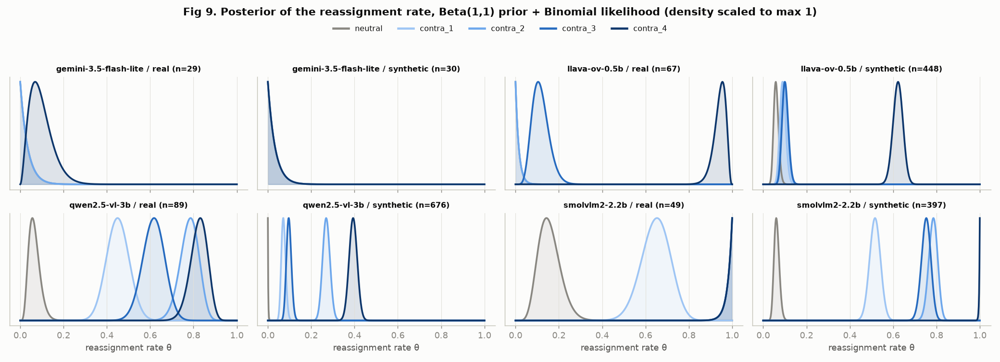
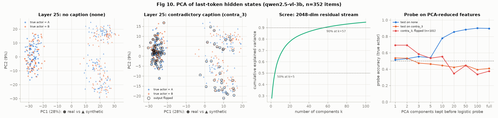

# Extra analyses (course-aligned)

Generated by `src/07_extras.py`.

## 1. Bayesian reassignment rate (Beta-Binomial)

Prior θ ~ Beta(1, 1) (uniform); likelihood k ~ Binomial(n, θ) over competent items; posterior θ | k ~ Beta(1 + k, 1 + n − k). Posterior probabilities from 40,000 Monte-Carlo draws.

| model | dataset | condition | n | k | RR | post_mean | cri_lo | cri_hi |
|---|---|---|---|---|---|---|---|---|
| gemini-3.5-flash-lite | real | neutral | 29 | 0 | 0.000 | 0.032 | 0.001 | 0.116 |
| gemini-3.5-flash-lite | real | contra_1 | 29 | 0 | 0.000 | 0.032 | 0.001 | 0.116 |
| gemini-3.5-flash-lite | real | contra_2 | 29 | 0 | 0.000 | 0.032 | 0.001 | 0.116 |
| gemini-3.5-flash-lite | real | contra_4 | 29 | 2 | 0.069 | 0.097 | 0.021 | 0.221 |
| gemini-3.5-flash-lite | synthetic | neutral | 30 | 0 | 0.000 | 0.031 | 0.001 | 0.112 |
| gemini-3.5-flash-lite | synthetic | contra_1 | 30 | 0 | 0.000 | 0.031 | 0.001 | 0.112 |
| gemini-3.5-flash-lite | synthetic | contra_2 | 30 | 0 | 0.000 | 0.031 | 0.001 | 0.112 |
| gemini-3.5-flash-lite | synthetic | contra_4 | 30 | 0 | 0.000 | 0.031 | 0.001 | 0.112 |
| llava-ov-0.5b | real | neutral | 67 | 0 | 0.000 | 0.014 | 0.000 | 0.053 |
| llava-ov-0.5b | real | contra_1 | 67 | 0 | 0.000 | 0.014 | 0.000 | 0.053 |
| llava-ov-0.5b | real | contra_2 | 67 | 0 | 0.000 | 0.014 | 0.000 | 0.053 |
| llava-ov-0.5b | real | contra_3 | 67 | 7 | 0.104 | 0.116 | 0.052 | 0.201 |
| llava-ov-0.5b | real | contra_4 | 67 | 64 | 0.955 | 0.942 | 0.876 | 0.984 |
| llava-ov-0.5b | synthetic | neutral | 448 | 26 | 0.058 | 0.060 | 0.040 | 0.084 |
| llava-ov-0.5b | synthetic | contra_1 | 448 | 40 | 0.089 | 0.091 | 0.066 | 0.119 |
| llava-ov-0.5b | synthetic | contra_2 | 448 | 44 | 0.098 | 0.100 | 0.074 | 0.129 |
| llava-ov-0.5b | synthetic | contra_3 | 448 | 45 | 0.100 | 0.102 | 0.076 | 0.132 |
| llava-ov-0.5b | synthetic | contra_4 | 448 | 279 | 0.623 | 0.622 | 0.577 | 0.666 |
| qwen2.5-vl-3b | real | neutral | 89 | 5 | 0.056 | 0.066 | 0.025 | 0.125 |
| qwen2.5-vl-3b | real | contra_1 | 89 | 40 | 0.449 | 0.451 | 0.350 | 0.553 |
| qwen2.5-vl-3b | real | contra_2 | 89 | 70 | 0.787 | 0.780 | 0.690 | 0.859 |
| qwen2.5-vl-3b | real | contra_3 | 89 | 55 | 0.618 | 0.615 | 0.514 | 0.712 |
| qwen2.5-vl-3b | real | contra_4 | 89 | 74 | 0.831 | 0.824 | 0.740 | 0.895 |
| qwen2.5-vl-3b | synthetic | neutral | 676 | 0 | 0.000 | 0.001 | 0.000 | 0.005 |
| qwen2.5-vl-3b | synthetic | contra_1 | 676 | 48 | 0.071 | 0.072 | 0.054 | 0.093 |
| qwen2.5-vl-3b | synthetic | contra_2 | 676 | 182 | 0.269 | 0.270 | 0.237 | 0.304 |
| qwen2.5-vl-3b | synthetic | contra_3 | 676 | 65 | 0.096 | 0.097 | 0.076 | 0.121 |
| qwen2.5-vl-3b | synthetic | contra_4 | 676 | 266 | 0.393 | 0.394 | 0.357 | 0.431 |
| smolvlm2-2.2b | real | neutral | 49 | 7 | 0.143 | 0.157 | 0.072 | 0.267 |
| smolvlm2-2.2b | real | contra_1 | 49 | 32 | 0.653 | 0.647 | 0.512 | 0.771 |
| smolvlm2-2.2b | real | contra_2 | 49 | 49 | 1.000 | 0.980 | 0.929 | 0.999 |
| smolvlm2-2.2b | real | contra_3 | 49 | 49 | 1.000 | 0.980 | 0.929 | 0.999 |
| smolvlm2-2.2b | real | contra_4 | 49 | 49 | 1.000 | 0.980 | 0.929 | 0.999 |
| smolvlm2-2.2b | synthetic | neutral | 397 | 24 | 0.060 | 0.063 | 0.041 | 0.088 |
| smolvlm2-2.2b | synthetic | contra_1 | 397 | 205 | 0.516 | 0.516 | 0.467 | 0.565 |
| smolvlm2-2.2b | synthetic | contra_2 | 397 | 312 | 0.786 | 0.784 | 0.743 | 0.823 |
| smolvlm2-2.2b | synthetic | contra_3 | 397 | 299 | 0.753 | 0.752 | 0.708 | 0.793 |
| smolvlm2-2.2b | synthetic | contra_4 | 397 | 397 | 1.000 | 0.997 | 0.991 | 1.000 |

Posterior effect probabilities:

| model | dataset | n | P(contra_1>neutral) | P(contra_2>neutral) | P(contra_4>neutral) | P(c1<c2<c4) | delta_c4_mean | delta_c4_lo | delta_c4_hi |
|---|---|---|---|---|---|---|---|---|---|
| gemini-3.5-flash-lite | real | 29 | 0.502 | 0.500 | 0.884 | 0.401 | 0.065 | -0.048 | 0.200 |
| gemini-3.5-flash-lite | synthetic | 30 | 0.502 | 0.498 | 0.501 | 0.165 | 0.000 | -0.090 | 0.090 |
| llava-ov-0.5b | real | 67 | 0.501 | 0.500 | 1.000 | 0.501 | 0.927 | 0.855 | 0.976 |
| llava-ov-0.5b | synthetic | 448 | 0.963 | 0.988 | 1.000 | 0.676 | 0.562 | 0.512 | 0.611 |
| qwen2.5-vl-3b | real | 89 | 1.000 | 1.000 | 1.000 | 0.775 | 0.758 | 0.658 | 0.844 |
| qwen2.5-vl-3b | synthetic | 676 | 1.000 | 1.000 | 1.000 | 1.000 | 0.392 | 0.356 | 0.430 |
| smolvlm2-2.2b | real | 49 | 1.000 | 1.000 | 1.000 | 0.500 | 0.824 | 0.705 | 0.915 |
| smolvlm2-2.2b | synthetic | 397 | 1.000 | 1.000 | 1.000 | 1.000 | 0.935 | 0.909 | 0.957 |

## H5 verdict (refreshed)

NOT supported (representation itself flips: probe reads the caption's person): layer 34 (probe acc on `none` 0.92; decodable from layer 23) recovers the true actor on 0.22 [0.15, 0.31] of 101 output-flipped items (qwen2.5-vl-3b)

## 2. PCA of hidden states + probe on reduced features

Layer 25 (best mid-layer probe on `none`). Standardised last-token residuals; PCA fit on `none`. 57 components keep 90% of the variance.

| layer | k | dims | acc_none | acc_contra3 | acc_contra3_flipped | n_flipped | var_explained |
|---|---|---|---|---|---|---|---|
| 25 | 1 | 1 | 0.514 | 0.537 | 0.693 | 101 | 0.279 |
| 25 | 2 | 2 | 0.528 | 0.534 | 0.693 | 101 | 0.369 |
| 25 | 3 | 3 | 0.554 | 0.474 | 0.584 | 101 | 0.438 |
| 25 | 5 | 5 | 0.540 | 0.463 | 0.535 | 101 | 0.531 |
| 25 | 10 | 10 | 0.778 | 0.446 | 0.554 | 101 | 0.662 |
| 25 | 20 | 20 | 0.855 | 0.423 | 0.347 | 101 | 0.777 |
| 25 | 50 | 50 | 0.884 | 0.446 | 0.446 | 101 | 0.888 |
| 25 | 100 | 100 | 0.901 | 0.395 | 0.337 | 101 | 0.948 |
| 25 | full | 2048 | 0.898 | 0.409 | 0.376 | 101 | 1.000 |

